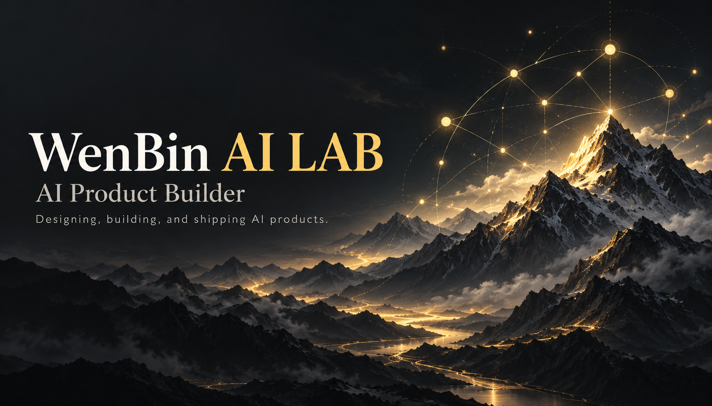
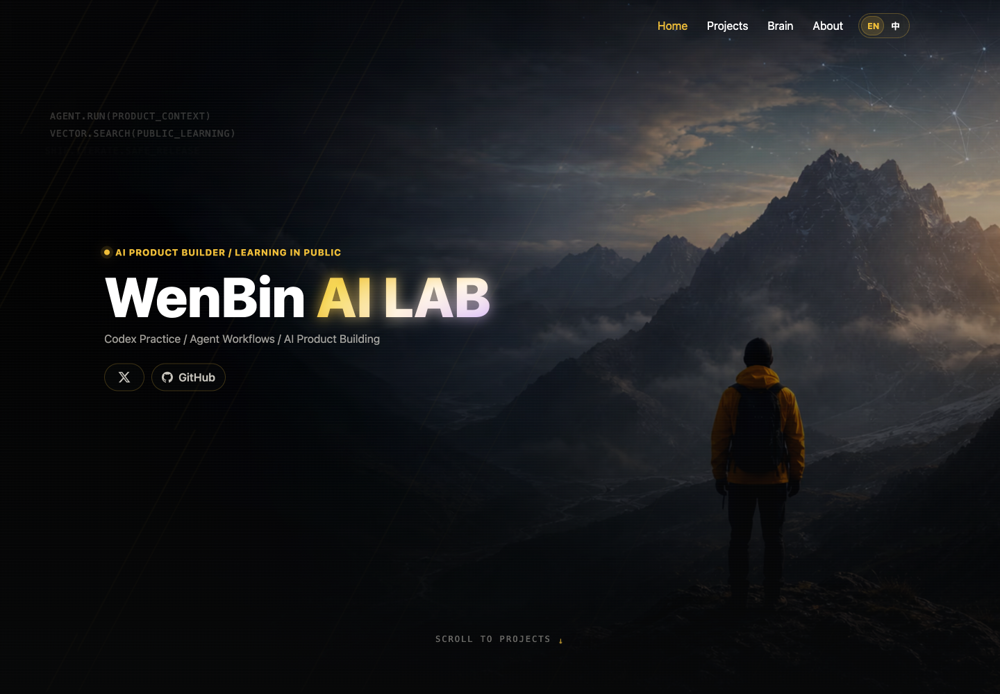

# WenBin AI LAB

**Designing, building, and shipping AI products. Learning in public.**

[](./LICENSE)
[](https://wenbinailab.com)

[English](./README.en.md) · [简体中文](./README.zh-CN.md) · [Visit website](https://wenbinailab.com)

WenBin AI LAB 是 Wenbin 的个人 AI 实验室，展示 AI 产品实践、Agent 工作流、知识系统与公开学习记录。

## About

WenBin AI LAB is Wenbin's personal brand website and a personal laboratory for AI product practice, Agent workflows, and knowledge systems. It brings together project showcases, practical articles, learning records, and social links.

- **AI product practice** — prototypes, tool exploration, and project milestones.
- **Agent workflows** — AI tool usage, automation practice, and workflow experiments.
- **Knowledge systems** — knowledge management and long-term learning.
- **Learning in public** — building processes and lessons learned.

This public repository contains documentation, visual assets, and collaboration configuration. The website source, build scripts, and deployment configuration are maintained in a separate private repository. Downloading this repository does not provide a locally runnable website.

## Installation and usage

Visit **[wenbinailab.com](https://wenbinailab.com)** in a browser. No installation is needed. Use the navigation available on the live website to explore its content.

To download the public documents and images, choose **Code → Download ZIP** on GitHub, or run:

```sh
git clone https://github.com/BeatsAD/WenBin-AI-LAB-Showcase.git
cd WenBin-AI-LAB-Showcase
```

Open a README in a Markdown viewer and keep the adjacent `assets/` directory. This repository has no application dependency manifest or application build commands.

See the [getting started guide](./docs/GETTING_STARTED.md) and [compatibility notes](./docs/COMPATIBILITY.md).

## Website preview

The cover is an AI-generated brand illustration. The screenshot below was captured from the live English homepage on October 18, 2026, at a 1440 × 1000 browser viewport. The site may change over time.



## Documentation

| Guide | Contents |
| --- | --- |
| [Getting started](./docs/GETTING_STARTED.md) | Website access, download, and reuse |
| [Compatibility](./docs/COMPATIBILITY.md) | Recommended environments and verification limits |
| [Contributing](./CONTRIBUTING.md) | Issues, contributions, and review |
| [Security policy](./SECURITY.md) | Private vulnerability reporting |
| [Changelog](./CHANGELOG.md) | Repository updates |

## Feedback and contributions

[Report a bug](https://github.com/BeatsAD/WenBin-AI-LAB-Showcase/issues/new?template=bug_report.yml) · [Suggest a feature](https://github.com/BeatsAD/WenBin-AI-LAB-Showcase/issues/new?template=feature_request.yml) · [Report a vulnerability privately](https://github.com/BeatsAD/WenBin-AI-LAB-Showcase/security/advisories/new)

Documentation, translation, link, and visual asset improvements are welcome. Read the [contribution guide](./CONTRIBUTING.md) before opening a pull request. Keep secrets and private information out of public issues and PRs.

## Author and links

**Wenbin · AI Product Builder**

[Website](https://wenbinailab.com) · [GitHub](https://github.com/BeatsAD) · [X](https://x.com/WenBin8nk)

## License

The public contents of this repository are available under the [MIT License](./LICENSE), allowing use, modification, and distribution while retaining the copyright and permission notice. Unpublished website source is outside this grant. Third-party trademarks and materials owned by others remain with their respective owners.
